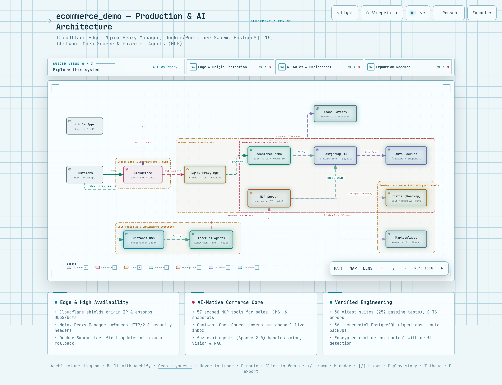
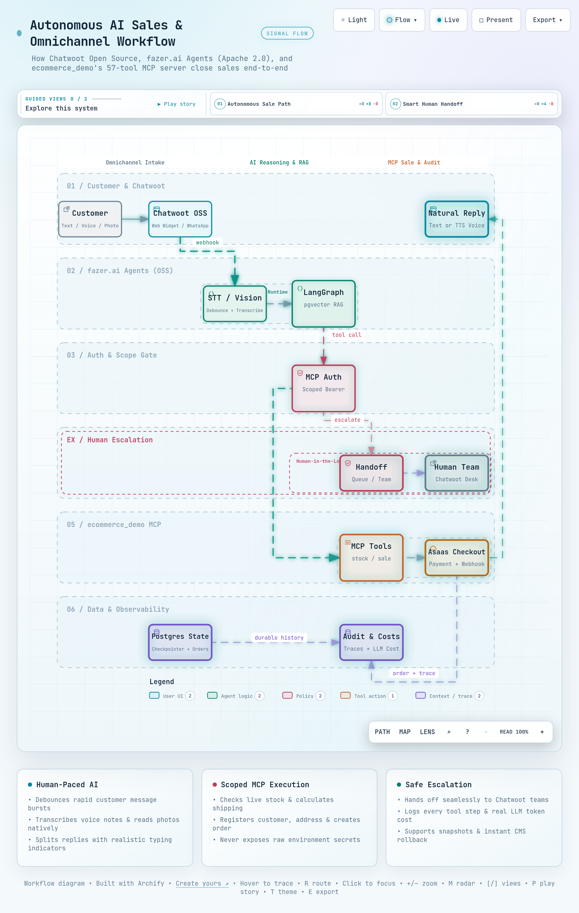

<div align="center">

# Aura Fragrance Co. — AI-Powered E-Commerce Showcase (`ecommerce_demo`)

**A live production showcase built to demonstrate real-world engineering of AI-driven web systems.**  
Next.js 16 · React 19 · PostgreSQL 15 · 57-Tool Built-In MCP Server · Chatwoot Open Source · `fazer.ai agents` (Apache 2.0) · Docker + Nginx + Cloudflare

[](https://demo.digitalarea.online)
[](https://nextjs.org)
[](https://react.dev)
[](https://www.typescriptlang.org)
[](https://www.postgresql.org)
[](#-quality--local-development)

<br />

<a href="https://demo.digitalarea.online">
  
</a>

<sub>Live storefront running at <a href="https://demo.digitalarea.online"><strong>demo.digitalarea.online</strong></a> — recorded directly from production.</sub>

</div>

---

## Why This Project Exists

Most e-commerce demos stop at a static product grid and a fake cart. This repository is a **working production showcase** designed to prove what an AI-native commerce stack looks like when built properly from the database up.

Running live at **[demo.digitalarea.online](https://demo.digitalarea.online)**, it combines a full-stack luxury fragrance storefront, a complete administrative CMS, an embedded **57-tool Model Context Protocol (MCP) server**, open-source omnichannel support via **Chatwoot**, and autonomous multimodal sales powered by **`fazer.ai agents` (Apache 2.0)**—all sitting behind a hardened **Cloudflare + Nginx + Docker** infrastructure built to handle traffic spikes without exposing the origin server.

---

## Storefront & Platform Capabilities

<table>
  <tr>
    <td width="50%">
      
      <p align="center"><sub><strong>Storefront & Dynamic CMS Hero</strong></sub></p>
    </td>
    <td width="50%">
      
      <p align="center"><sub><strong>Catalog, Filters & Live Stock</strong></sub></p>
    </td>
  </tr>
  <tr>
    <td width="50%">
      
      <p align="center"><sub><strong>Product Page, Checkout CTA & Concierge Chat</strong></sub></p>
    </td>
    <td width="50%">
      
      <p align="center"><sub><strong>Curated Fragrance Gallery</strong></sub></p>
    </td>
  </tr>
</table>

### Customer Experience
- **Dynamic Storefront & CMS (`/`)**: Hero carousels, featured collections, announcement bars, testimonials, and editable content blocks stored in PostgreSQL and rendered with React Server Components.
- **Fragrance Catalog (`/catalogo` & `/catalogo/produto/[slug]`)**: Search, brand ordering, category/olfactory filtering, stock badges, lightweight `.jpg` product media, and programmatic out-of-stock inquiry routing directly into live chat.
- **Cart & Checkout (`/loja/carrinho` & `/loja/checkout`)**: Persistent cart, real-time coupon validation (`/api/cupons/validar`), configurable shipping calculation, payment-method discount rules, and **Asaas** payment integration with verified webhooks (`/api/webhooks/asaas`).
- **Customer Portal (`/minha-conta`)**: Secure registration and login using JWT + bcrypt and Google OAuth (`/api/auth/google`), order history with tracking links, and saved shipping addresses.
- **Curated Gallery (`/galeria`)**: High-resolution catalog photography managed directly from the admin panel.

### Administrative Console (`/admin`)
- **Operations Dashboard**: Sales overview, active orders, leads, and system health.
- **Catalog, Orders & Tracking**: Full CRUD for products, stock levels, order status updates, and shipment tracking links.
- **Campaigns, Leads & Paid Traffic**: Promotional banners with AI-assisted copy support, automatic coupon binding, lead-to-order conversion tracking, and **per-route Google Tags injection** via Next.js middleware (`x-pathname`).
- **Site Snapshots & Automated Backups**: Scheduled database/asset backups (`/api/cron/backup`) stored on persistent Docker volumes, plus on-demand site snapshots and instant CMS rollback.
- **Governance & Security Controls**: Audit logs (`/admin/auditoria`), configurable API rate limiting (`/admin/configuracoes/limites`), role-based admin user management, **encrypted runtime environment overrides with drift detection**, and scoped MCP token management (`/admin/mcp-tokens`).

### Built-In 57-Tool MCP Server (`/api/mcp`)
Instead of bolting AI onto the frontend as a simple FAQ widget, the application ships with a **Streamable HTTP Model Context Protocol server** (`@modelcontextprotocol/sdk`) authenticated via scoped Bearer tokens. Any MCP-compatible agent (`fazer.ai agents`, Claude, Cursor, or custom orchestrators) can safely operate the store:

- **End-to-End Autonomous Sales**: `consultar_produto`, `calcular_entrega`, `registrar_cliente`, `registrar_endereco`, `dar_baixa_produto`, `realizar_venda`, and `atualizar_rastreio_pedido`.
- **AI Asset Generation**: `gerar_imagem_ia` for generating product and campaign imagery on demand.
- **Site Snapshots & Rollback**: `listar_snapshots_site`, `criar_snapshot_site`, and `restaurar_snapshot_site`.
- **Full Store & CMS Control**: Read/write tools for pages, blocks, carousel, gallery, testimonials, campaigns, leads, appointments, orders, WhatsApp/Chatwoot settings, and safe environment health checks (`ler_ambiente` reports configuration status and drift without ever returning secret values).

---

## System Architecture & Production Infrastructure

The diagram below was generated with **Archify** (an interactive version with zoom, guided views, and dark/light toggle is available in [`docs/architecture.html`](docs/architecture.html)).

<p align="center">
  
</p>

### How Cloudflare, Nginx, and Docker Protect and Scale the System

Production traffic never touches the application server or database directly. Three distinct layers optimize hardware resources, shield the origin, and absorb heavy demand:

1. **Cloudflare (Edge CDN, WAF & Origin Shield)**
   - **Origin IP Protection**: Public DNS resolves only to Cloudflare's edge network, hiding the real server IP from direct scans and volumetric attacks.
   - **WAF & DDoS Mitigation**: Blocks malicious bots, credential stuffing, and Layer 7 floods before they consume origin CPU or memory.
   - **Global Edge Caching**: Offloads static Next.js chunks, fonts, and product `.jpg` assets to Cloudflare PoPs worldwide, cutting origin bandwidth and keeping page loads fast under high concurrency.

2. **Nginx Proxy Manager (Reverse Proxy & Traffic Control)**
   - **HTTP/2 & Compression**: Terminates and multiplexes traffic cleanly across the `npm_swarm` Docker network.
   - **Strict Security Headers**: Enforces `X-Frame-Options: DENY`, `X-Content-Type-Options: nosniff`, `Referrer-Policy: strict-origin-when-cross-origin`, and restrictive `Permissions-Policy`.
   - **Clean Virtual Host Routing**: Maps `demo.digitalarea.online` directly to the internal container without exposing host ports unnecessarily.

3. **Docker & Portainer (Container Isolation & Zero-Downtime Ops)**
   - **Hardened Multi-Stage Build**: `Dockerfile` compiles Next.js in `output: 'standalone'` mode on `node:20-alpine` and executes as an unprivileged `nextjs:nodejs` user—smaller image footprint, smaller attack surface.
   - **Network Segmentation**: PostgreSQL 15 runs strictly on a private Docker overlay network (`internal`) with zero public port bindings. Only the application container can query it.
   - **Zero-Downtime Rolling Updates**: `docker-compose.prod.yml` uses `order: start-first` with `/api/ready` and `pg_isready` healthchecks plus automatic rollback (`failure_action: rollback`) if a release fails health verification.
   - **Persistent Volumes & Rate Limiting**: Database state (`pg_data`) and automated backups (`backups_data`) persist across deployments, backed by application-level rate limiting to protect sensitive endpoints.

---

## Omnichannel Hub & Self-Reinforcing Sales Funnel with Chatwoot (Open Source)

The storefront connects directly to a self-hosted **Chatwoot Open Source** instance (including the open-source WhatsApp and operational enhancements from [`fazer-ai/chatwoot`](https://github.com/fazer-ai/chatwoot)). Rather than treating each messaging platform as a separate silo, Chatwoot centralizes **Website Live Chat, WhatsApp, Instagram, Facebook, Email, and other channels** inside one workspace where every channel is handled on equal footing:

- **Channel Equality & Centralized Queue**: Whether a customer starts on the website widget, replies to an Instagram DM, or sends a WhatsApp voice note, the conversation follows the exact same routing, automation rules, SLAs, and AI/human tooling.
- **Persistent Unified Customer Profiles**: Every interaction across channels is tied back to a single customer profile—preserving conversation history, scent preferences, custom attributes, tags, and order context even when the buyer switches from Instagram to WhatsApp or the web storefront.
- **Self-Reinforcing Sales Funnel**: Incoming conversations automatically enter a structured sales pipeline. As the AI agent or human team qualifies the lead, closes an order, and follows up post-purchase, the resulting purchase history and preferences continuously enrich the customer profile—powering smarter recommendations, targeted re-engagement, and repeat sales that feed right back into the funnel.
- **Dynamic Widget Integration (`ChatWidget.tsx`)**: Reads the Chatwoot base URL and website token dynamically from CMS settings or environment variables, keeping the live concierge available across every page.
- **Programmatic Conversation Handshake (`/api/chatwoot/pedir`)**: When a visitor requests an out-of-stock fragrance or schedules a consultation, the backend opens a Chatwoot conversation via API with the exact product context, receives the session `authToken` JWT, and hands it to the browser so the chat widget opens right inside that active thread.

### Key Open-Source Chatwoot Capabilities
- **Unified Omnichannel Inbox**: Website Live Chat, WhatsApp (native QR connector or official Cloud API), Instagram, Facebook, Email, and API channels treated equally under one roof.
- **Customer CRM & Enrichment**: Persistent contact profiles, custom contact/conversation attributes, interaction timelines, labels, and personal or global custom filters.
- **Team Collaboration & Routing**: Multi-agent queues, team assignment, conversation locking, collision prevention, and internal team chat with threads and mentions.
- **Productivity & Automation**: Canned responses, scheduled/recurring messages, and automated triggers (including idle-conversation and message-edit rules).
- **Integrations & White-Labeling**: Per-inbox webhooks with retries, observer bots (for silent classification/QA), S3-compatible media storage (MinIO/R2), custom branding, and native connection to `fazer.ai agents`.

---

## Autonomous AI Sales with `fazer.ai agents` (Free Open-Source — Apache 2.0)

While Chatwoot handles customer channels, **[`fazer.ai agents`](https://github.com/fazer-ai/agents)** (Free Open-Source edition under the **Apache 2.0** license) powers the autonomous AI sales and support layer. Connected to Chatwoot inboxes on one side and `ecommerce_demo`'s **57-tool `/api/mcp` server** on the other, the agent listens to audio, inspects photos, checks real stock, calculates shipping, closes orders, and escalates to a human operator when needed.

<p align="center">
  
</p>

<sub>Interactive workflow diagram available in <a href="docs/ai-sales-workflow.html"><code>docs/ai-sales-workflow.html</code></a>.</sub>

### Complete Feature Matrix — `fazer.ai agents` (Free Open-Source Edition / Apache 2.0)

Every capability listed below is included in the **free, open-source Apache 2.0 edition** of [`fazer-ai/agents`](https://github.com/fazer-ai/agents):

| Category | Feature | Description |
| :--- | :--- | :--- |
| **Agent Runtime** | **LangGraph TS Runtime** | Stateful agent execution graph with durable per-conversation memory checkpointed in PostgreSQL. |
| **Agent Runtime** | **Multi-Model Support** | Assign any provider per agent: OpenAI, Anthropic, Google, DeepSeek, OpenRouter, or local models (Ollama, LM Studio, vLLM) via OpenAI-compatible endpoints. |
| **Agent Runtime** | **Progressive Agent Editor** | Unified workspace to configure system prompts, behavior rules, tools, and knowledge bases. |
| **Agent Runtime** | **Built-In Playground** | Interactive sandbox to test agent responses and tool calls before going live. |
| **Channels (Chatwoot)** | **Multi-Inbox Routing** | Connect a single AI agent to multiple Chatwoot inboxes with per-inbox routing rules. |
| **Channels (Chatwoot)** | **WhatsApp 24h Window & HSM** | Respects Meta's 24-hour messaging window and supports approved HSM templates for proactive outreach. |
| **Channels (Chatwoot)** | **Channel Redirection** | Use official WhatsApp as the entry point and transition ongoing conversations to the website chat to reduce per-message costs. |
| **Channels (Chatwoot)** | **Full Omnichannel** | Operates across every channel supported by Chatwoot (Web, WhatsApp, Instagram, Email, etc.). |
| **Multimodal & UX** | **Speech-to-Text (STT)** | Transcribes customer voice notes natively using OpenAI, Gemini, ElevenLabs, or OpenAI-compatible endpoints. |
| **Multimodal & UX** | **Text-to-Speech (TTS)** | Replies with natural voice notes (OpenAI / ElevenLabs) while honoring per-contact audio vs. text preferences. |
| **Multimodal & UX** | **Vision** | Reads and interprets customer-sent images and documents directly inside the conversation. |
| **Multimodal & UX** | **Message Debounce** | Groups rapid bursts of consecutive customer messages into a single coherent turn before replying. |
| **Multimodal & UX** | **Message Splitting & Typing** | Breaks long replies into natural bubbles with realistic `"typing..."` indicators. |
| **Tools & Knowledge** | **RAG Knowledge Base (`pgvector`)** | Vector-indexed knowledge base in PostgreSQL with a human approval queue for new knowledge suggestions. |
| **Tools & Knowledge** | **Native & Custom HTTP Tools** | Define custom HTTP integrations with JSON schemas, host allowlists, and vault-stored credentials. |
| **Tools & Knowledge** | **External MCP & Toolpacks** | Plug directly into external MCP servers (such as this store's `/api/mcp`) and curated toolpacks. |
| **Sales & Operations** | **Google Calendar Scheduling** | Books customer appointments directly on Google Calendar with automated reminders. |
| **Sales & Operations** | **Proactive Follow-Ups** | Schedules automated follow-up messages that respect configured business hours. |
| **Sales & Operations** | **Smart Human Handoff** | Routes escalated conversations to a specific queue, team, or human agent inside Chatwoot. |
| **Sales & Operations** | **Sales Funnel Kanban** | Moves deal cards automatically across pipeline stages as conversations progress *(requires Chatwoot fazer.ai Pro)*. |
| **Operator Console** | **KPI & Real LLM Cost Dashboard** | Tracks real token usage and exact LLM costs aggregated from application execution logs. |
| **Operator Console** | **Conversation Inspector** | Detailed thread view with error flags and one-click re-engagement actions. |
| **Operator Console** | **Reusable Building-Block Pools** | Modular prompt and behavior components shared across multiple agents. |
| **Operator Console** | **Multi-Language & Themes** | Operator console with built-in i18n and light/dark themes. |
| **Platform & API** | **REST v1 + MCP Server + Web UI** | Three ways to control the platform, including an OAuth 2.1 MCP server with **dry-run enabled by default** on write tools. |
| **Platform & API** | **Outgoing Webhooks** | HMAC-signed webhook delivery with exponential backoff retries and a dead-letter queue (DLQ). |
| **Platform & API** | **Step-by-Step Execution Logs** | Granular trace per execution step with retention policies and Discord/webhook alerting. |
| **Security & Self-Host** | **Encrypted Secrets Vault** | Stores LLM API keys and tool credentials encrypted at rest. |
| **Security & Self-Host** | **JWT + Google Auth** | First-access onboarding setup, registration controls, and JWT/Google authentication. |
| **Security & Self-Host** | **PostgreSQL RLS & Least Privilege** | Row-Level Security policies paired with a non-superuser runtime database role. |
| **Security & Self-Host** | **Self-Hosted Deploy** | Ready for Docker, Docker Compose, Portainer, or Coolify on your own VPS. |

---

## Roadmap

The modular architecture in `ecommerce_demo` is intentionally structured to support the next phase of expansion:

- [ ] **Multi-Language & Multi-Currency (`i18n`)**: Full localization of storefront routes, catalog attributes, checkout flows, transactional emails, and admin views across multiple languages and currencies.
- [ ] **Mobile Applications (Android & iOS)**: Dedicated mobile shopping experience backed by the existing API layer, with native push notifications, order tracking, and instant concierge chat.
- [ ] **Major Marketplace Connectors**: Bi-directional catalog, pricing, inventory, and order synchronization with leading marketplaces including **Amazon, Mercado Livre, Shopee, and Shopify**.
- [ ] **Automated Ad & Social Publishing via Postiz (Self-Hosted)**: Direct integration with self-hosted **[Postiz](https://github.com/gitroomhq/postiz-app)** to schedule product launches, promotional campaigns, and AI-assisted advertising posts across social channels from a single workflow.

---

## Quality & Local Development

The codebase enforces strict TypeScript (`tsc --noEmit` with zero errors), Clean Architecture boundaries, and automated verification:

- **30 Vitest test suites / 252 passing tests** covering checkout calculations, Asaas webhook verification, MCP server & scoped tokens, encrypted environment management & drift detection, coupons, shipping rules, payment-method discounts, Google Tags, audit logs, and automated backups.
- **36 incremental PostgreSQL migrations** in [`migrations/`](migrations/).
- **Technical Spec-Kit** in [`specs/`](specs/) (`01_PROJECT_CHARTER.md`, `02_ARCHITECTURE.md`, `03_DATA_DICTIONARY.md`, `04_TASKS.md`).

### Running Locally

```bash
# 1. Clone the repository
git clone https://github.com/empresacontalo/ecommerce_demo.git
cd ecommerce_demo

# 2. Install dependencies
npm install

# 3. Configure environment variables
cp .env.production.example .env.local
# Fill in PostgreSQL, JWT, Asaas, Chatwoot, and MCP_ADMIN_TOKEN values

# 4. Run the test suite & type check
npm test
npx tsc --noEmit

# 5. Start development server
npm run dev
```

### Production Container Deployment

```bash
docker compose -f docker-compose.prod.yml up -d --build
```

---

<div align="center">
  <p><strong>Live Showcase:</strong> <a href="https://demo.digitalarea.online">https://demo.digitalarea.online</a></p>
  <sub>Built to demonstrate end-to-end engineering of modern AI-powered production systems.</sub>
</div>
