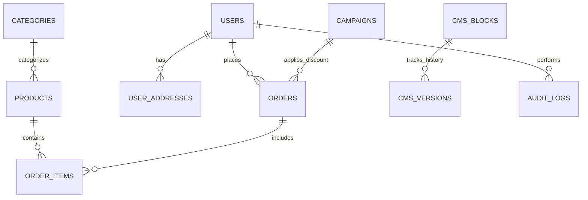

# Spec-Kit: Data Dictionary & Schema Specification

## 1. Relational Database Schema (PostgreSQL)

---

## 2. Core Entities & Tables

### 2.1 Table: `users`
Represents administrators and registered customers.

| Column | Type | Constraints | Description |
| :--- | :--- | :--- | :--- |
| `id` | UUID | PRIMARY KEY, DEFAULT gen_random_uuid() | Unique identifier |
| `name` | VARCHAR(150) | NOT NULL | User's full name |
| `email` | VARCHAR(255) | UNIQUE, NOT NULL | Primary login email |
| `password_hash` | VARCHAR(255) | NOT NULL | Bcrypt hashed credential |
| `role` | VARCHAR(20) | DEFAULT 'customer' | Role: `'admin'` or `'customer'` |
| `phone` | VARCHAR(50) | NULL | Contact telephone |
| `is_active` | BOOLEAN | DEFAULT TRUE | Account activity status |
| `created_at` | TIMESTAMPTZ | DEFAULT NOW() | Record creation timestamp |
| `updated_at` | TIMESTAMPTZ | DEFAULT NOW() | Last update timestamp |

**Default Seed Admin:**
- **Email**: `admin@example.com`
- **Password (plaintext)**: `password`
- **Role**: `admin`

---

### 2.2 Table: `categories`
Olfactory fragrance classifications.

| Column | Type | Constraints | Description |
| :--- | :--- | :--- | :--- |
| `id` | UUID | PRIMARY KEY, DEFAULT gen_random_uuid() | Category identifier |
| `name` | VARCHAR(100) | NOT NULL | Category name (e.g. Woody, Oriental) |
| `slug` | VARCHAR(120) | UNIQUE, NOT NULL | URL-friendly slug |
| `description` | TEXT | NULL | Olfactory family profile description |
| `sort_order` | INT | DEFAULT 0 | Display priority ordering |

**Standard Categories:**
1. `oriental-spicy` (Oriental & Spicy)
2. `woody-oud` (Woody & Pure Oud)
3. `fresh-citrus` (Fresh & Citrus Notes)
4. `floral-delicate` (Floral & Delicate Musk)
5. `gourmand-sweet` (Gourmand & Amber)

---

### 2.3 Table: `products`
The luxury fragrance catalog items.

| Column | Type | Constraints | Description |
| :--- | :--- | :--- | :--- |
| `id` | UUID | PRIMARY KEY, DEFAULT gen_random_uuid() | Product identifier |
| `category_id` | UUID | REFERENCES categories(id) | Olfactory family |
| `name` | VARCHAR(200) | NOT NULL | Fragrance name |
| `brand` | VARCHAR(100) | NOT NULL | Brand (e.g. Lattafa, Al Wataniah) |
| `slug` | VARCHAR(220) | UNIQUE, NOT NULL | URL slug |
| `description` | TEXT | NOT NULL | Detailed scent profile |
| `top_notes` | VARCHAR(255) | NULL | Scent pyramid: Top notes |
| `heart_notes` | VARCHAR(255) | NULL | Scent pyramid: Heart notes |
| `base_notes` | VARCHAR(255) | NULL | Scent pyramid: Base notes |
| `price` | NUMERIC(10,2) | NOT NULL | Retail unit price (USD) |
| `sale_price` | NUMERIC(10,2) | NULL | Promotional discounted price |
| `stock_quantity` | INT | DEFAULT 0 | Inventory in stock |
| `image_url` | VARCHAR(500) | NOT NULL | Primary `.jpg` asset path |
| `is_featured` | BOOLEAN | DEFAULT FALSE | Highlighted on homepage |
| `is_active` | BOOLEAN | DEFAULT TRUE | Availability toggle |
| `created_at` | TIMESTAMPTZ | DEFAULT NOW() | Timestamp |

---

### 2.4 Table: `gallery_items`
Showcases visual catalog assets (repurposing the legacy gallery exclusively with registered product photography).

| Column | Type | Constraints | Description |
| :--- | :--- | :--- | :--- |
| `id` | UUID | PRIMARY KEY, DEFAULT gen_random_uuid() | Asset identifier |
| `product_id` | UUID | REFERENCES products(id) | Associated perfume product |
| `title` | VARCHAR(200) | NOT NULL | Display title in English |
| `image_url` | VARCHAR(500) | NOT NULL | Lightweight `.jpg` image path |
| `aspect_ratio` | VARCHAR(20) | DEFAULT '1:1' | Visual layout ratio |
| `sort_order` | INT | DEFAULT 0 | Order in gallery grid |
| `is_active` | BOOLEAN | DEFAULT TRUE | Display flag |

---

### 2.5 Table: `orders` & `order_items`
E-commerce transactional tracking.

**`orders`:**
- `id`: UUID (PK)
- `order_number`: VARCHAR(50) UNIQUE (e.g., `ORD-2026-1001`)
- `user_id`: UUID (FK -> users, nullable for guest checkout)
- `status`: VARCHAR(30) (e.g., `pending`, `confirmed`, `shipped`, `delivered`, `cancelled`)
- `subtotal`: NUMERIC(10,2)
- `discount_amount`: NUMERIC(10,2) DEFAULT 0
- `shipping_amount`: NUMERIC(10,2) DEFAULT 0
- `total_amount`: NUMERIC(10,2)
- `payment_method`: VARCHAR(50) (e.g., `credit_card`, `wallet`)
- `payment_status`: VARCHAR(30)
- `shipping_address`: JSONB (Recipient, Street, City, State, ZIP, Country)
- `created_at`: TIMESTAMPTZ

**`order_items`:**
- `id`: UUID (PK)
- `order_id`: UUID (FK -> orders)
- `product_id`: UUID (FK -> products)
- `unit_price`: NUMERIC(10,2)
- `quantity`: INT
- `total_price`: NUMERIC(10,2)

---

### 2.6 Table: `cms_config`
Key-value configuration store for white-labeled brand parameters and site metadata.

| Key | Sample Seed Value (English / Fictional) |
| :--- | :--- |
| `company.name` | `Aura Fragrance Co.` |
| `company.tagline` | `The Art of Timeless Scent & Modern Elegance` |
| `company.email` | `concierge@aurafragrances.demo` |
| `company.phone` | `+1 (212) 555-0198` |
| `company.address_line1` | `742 Fifth Avenue, Suite 1200` |
| `company.city` | `New York` |
| `company.state` | `NY` |
| `company.postal_code` | `10022` |
| `company.country` | `United States` |
| `company.instagram` | `aurafragrance.demo` |
| `company.facebook` | `aurafragrancedemo` |
| `header.announcement` | `Complimentary shipping on all luxury orders over $150` |
